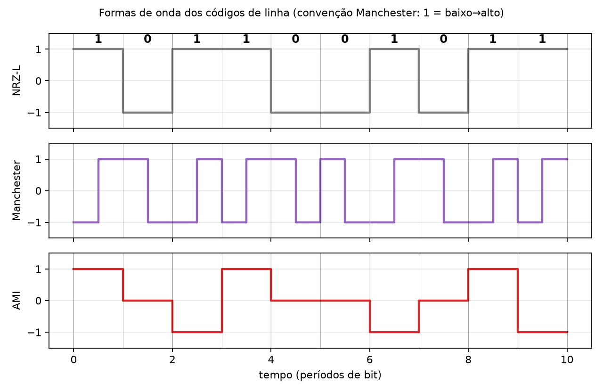
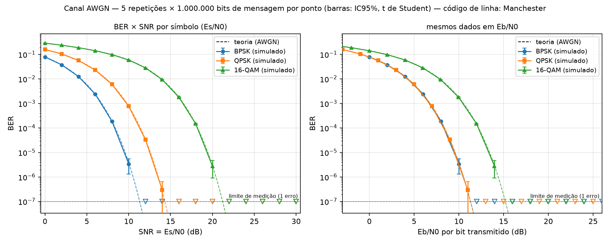
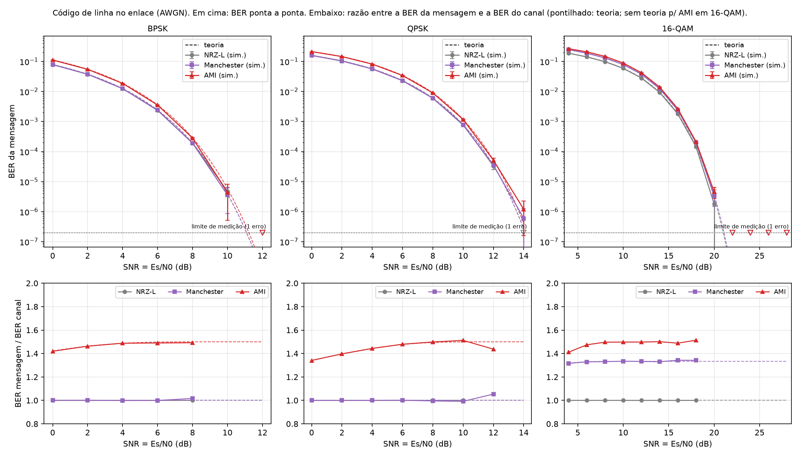
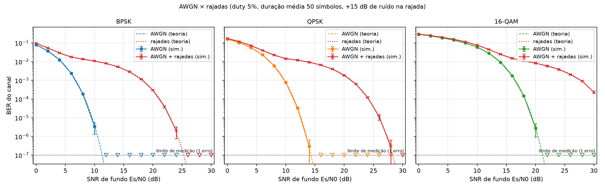
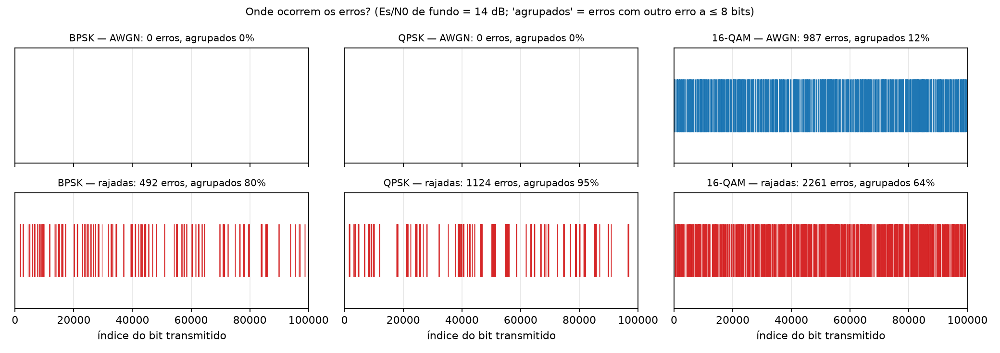
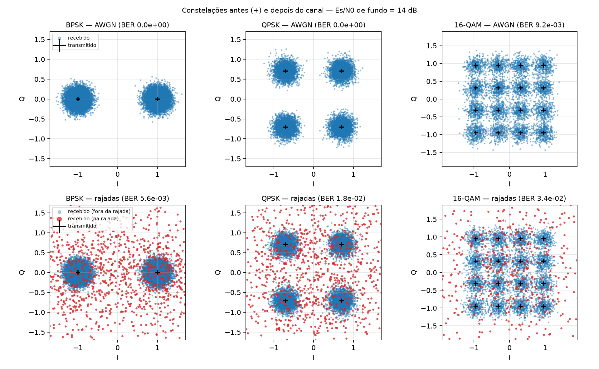
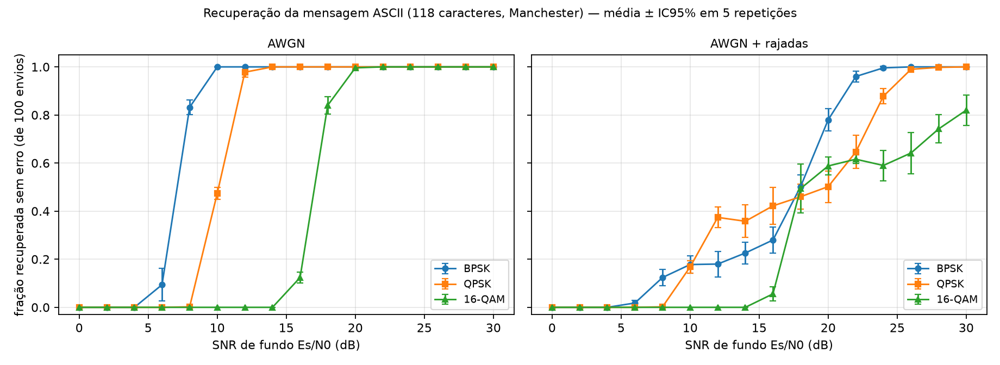
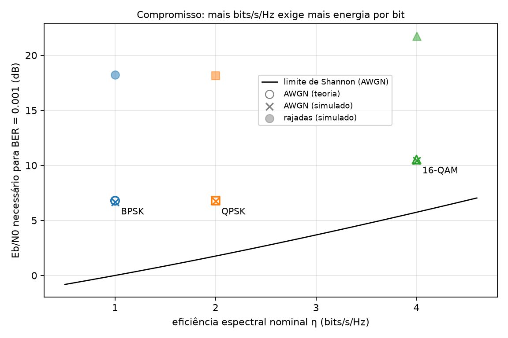

# Simulador de Transmissão Digital — codificação de linha, modulação e canal ruidoso

**Redes de Computadores — UNISINOS · Trabalho II (GB) · Prof. Cristiano Bonato Both**
**Dupla:** `<NOME 1>` e `<NOME 2>` · **Apresentação e entrega:** 19/11/2026

Simulador ponta a ponta em Python (NumPy/SciPy) que transmite uma mensagem ASCII por um enlace digital,
com **2+1 códigos de linha** (Manchester, AMI e NRZ-L de referência), **3 modulações** (BPSK, QPSK, 16-QAM),
**2 cenários de canal** (AWGN e AWGN + rajadas) e avalia **BER × SNR** e **eficiência espectral**
com experimentos reprodutíveis (16 SNRs × 5 repetições × 1.000.000 de bits por ponto).

> 🎥 **Vídeo (≤ 5 min):** `<LINK OU CAMINHO DO ARQUIVO NO REPOSITÓRIO>`

---

## 1. Resumo dos resultados

| Pergunta | Resposta medida |
|---|---|
| A simulação reproduz a teoria? | Sim. Desvio mediano de 0,2–1,1 % e máximo de 5 % em relação às curvas teóricas (pontos com ≥ 1000 erros) — AWGN e rajadas. |
| Custo de energia da ordem de modulação? | Para BER do canal = 10⁻³: Es/N0 = 6,8 dB (BPSK), 9,8 dB (QPSK), 16,5 dB (16-QAM). Em **Eb/N0**: 6,8 / 6,8 / 10,5 dB — QPSK dobra a eficiência espectral **sem custo** de Eb/N0 sobre o BPSK; 16-QAM custa +3,7 dB. |
| O que a codificação de linha faz com a BER? | Manchester: BER da mensagem = BER do canal (em 16-QAM, ×1,33 por proteção desigual do Gray). AMI (com nosso mapeamento 2 bits/pulso): ×1,5. Ambas **detectam** erros (violações), **nenhuma corrige**. |
| Efeito das rajadas? | Penalidade de **≈ 11,4 dB** para BER = 10⁻³ em todas as modulações; erros ficam agrupados (79–95 % dos erros com outro erro a ≤ 8 bits, contra 0–13 % no AWGN) e a BER passa a cair devagar com o SNR. |
| Recuperação da mensagem (Manchester)? | AWGN: 100 % a partir de 10 dB (BPSK), 14 dB (QPSK) e 22 dB (16-QAM; 99,6 % a 20 dB). Com rajadas, mesmo a 30 dB: BPSK/QPSK 100 %, 16-QAM 82 %. |

---

## 2. Como cada requisito do enunciado é atendido

| Requisito | Onde / evidência |
|---|---|
| Mensagem ASCII → bits | `commdigital/source.py` (8 bits/caractere, MSB primeiro) |
| ≥ 2 codificações de linha + diferença para correção de erros | `commdigital/line_coding.py` (NRZ-L, **Manchester**, **AMI**) · seção 5 |
| ≥ 3 modulações (uma de ordem superior) | `commdigital/modulation.py` (BPSK, QPSK, **16-QAM**, Gray) |
| AWGN com controle de SNR + segundo cenário | `commdigital/channel.py` (`awgn`, `burst_awgn` — Gilbert-Elliott) |
| Demodular, decodificar, reconstruir, identificar bits incorretos | `commdigital/pipeline.py` · `scripts/demo_mensagem.py` (lista posições dos bits errados) |
| BER e eficiência espectral nominal | `commdigital/metrics.py` · `results/tabela_compromisso.md` |
| ≥ 8 SNRs, parâmetros equivalentes | 16 valores (0–30 dB, passo 2) · mesmo Es = 1, mesma taxa de símbolos, mesmos bits por repetição |
| ≥ 100.000 bits por combinação, ≥ 5 repetições | **1.000.000 bits × 5 repetições** (justificativa na seção 7) |
| Curvas BER × SNR com variabilidade | `results/figures/fig02…fig04` (média ± IC95 %, t de Student, n = 5) |
| AWGN × segundo cenário | `fig04`, `fig05`, `fig07` · seção 8 |
| Tabela de compromisso BER × eficiência espectral | `results/tabela_compromisso.md`, `fig08` · seção 8.4 |
| Teste de consistência | `scripts/teste_consistencia.py` → `results/consistencia.md` |
| Configurações, resultados brutos e scripts | `results/raw/{config.json, ber_runs.csv, mensagem_runs.csv}` · `run_all.sh` |
| Aprofundamento (opcional) | Constelações antes/depois (`fig06`); curvas teóricas AWGN e de rajadas sobre os dados; limite de Shannon (`fig08`); ablação do embaralhador |

---

## 3. Instalação e execução

Requer Python ≥ 3.9.

```bash
python -m venv .venv && source .venv/bin/activate      # Windows: .venv\Scripts\activate
pip install -r requirements.txt

python scripts/demo_mensagem.py --modulation 16qam --snr 14               # demonstração com a mensagem ASCII
python scripts/demo_mensagem.py --line-code ami --modulation qpsk --channel burst --snr 12
python -m pytest -q                                                       # 44 testes
python scripts/demo_video.py                                              # demonstração automática, com legendas, para gravar vídeo sem narração
./run_all.sh                                                              # reproduz TUDO (~2 min)
```

Passo a passo individual:

```bash
python scripts/teste_consistencia.py     # -> results/consistencia.md
python scripts/ablacao_scrambler.py      # -> results/ablacao_scrambler.md
python scripts/executar_experimentos.py  # -> results/raw/*.csv + config.json   (~1,5 min; --quick p/ teste rápido)
python scripts/gerar_figuras.py          # -> results/figures/*.png + tabelas .md/.csv
```

---

## 4. Arquitetura do simulador


| Módulo | Responsabilidade |
|---|---|
| `source.py` | texto ↔ bits, bits aleatórios, impressão legível |
| `line_coding.py` | NRZ-L, Manchester, AMI (encode/decode + contagem de violações) |
| `scrambler.py` | embaralhador aditivo síncrono PRBS-15 (x¹⁵+x¹⁴+1) |
| `modulation.py` | BPSK, QPSK, 16-QAM em banda base equivalente, mapeamento Gray, Es = 1 |
| `channel.py` | AWGN (SNR = Es/N0) e AWGN + rajadas (Markov de 2 estados) |
| `pipeline.py` | `simulate_link()`: encadeia tudo e devolve bits/símbolos/máscara de rajada |
| `metrics.py` | BER, posições de erro, agrupamento de erros, erros por caractere, η |
| `theory.py` | BER teórica (AWGN, por posição de bit; rajadas; mensagem por código de linha); limite de Shannon |

### Decisões de projeto importantes

* **Banda base equivalente, 1 amostra/símbolo.** Pulso de Nyquist ideal + filtro casado, sem ISI; sincronismo perfeito.
  Logo **η nominal = log₂M bit/s/Hz** (B = Rs). A **η líquida** = η × taxa do código de linha.
* **SNR = Es/N0 (por símbolo)**, com Es = 1. Para comparar modulações com a *mesma potência e a mesma banda*, esse é o
  eixo natural; também mostramos **Eb/N0** = Es/N0 − 10·log₁₀(bits/símbolo) (fig02, direita).
* **Códigos de linha binários alimentam o modulador.** NRZ-L: identidade. Manchester: cada bit vira 2 chips
  (convenção G. E. Thomas/Stallings: 1 = baixo→alto = (0,1); 0 = alto→baixo = (1,0)).
  **AMI:** símbolo ternário (0, +1, −1) transmitido como palavra de 2 bits (0→00, +→01, −→10; 11 inválida). Essa adaptação é
  necessária porque os moduladores são binários; **dobra** o fluxo, o que penaliza a η líquida do AMI neste simulador
  (num enlace de banda base real com pulsos de 3 níveis, o AMI usaria 1 símbolo por bit).
* **Embaralhador (PRBS-15) antes do modulador.** Sem ele, a estrutura de Manchester/AMI torna os pontos da constelação
  não equiprováveis (média ≠ 0 e, no AMI + 16-QAM, Es ≈ 1,40 em vez de 1), invalidando o SNR nominal
  (`results/ablacao_scrambler.md`). O embaralhador é um XOR: **não propaga erros**.
* **Decisão rígida (hard decision)** e decodificadores de linha simples (Manchester decide pelo 2º chip; AMI decide "há pulso ⇒ 1").

---

## 5. Codificação de linha × codificação de correção de erros

| | **Codificação de linha** | **Codificação de canal (correção de erros, FEC)** |
|---|---|---|
| Objetivo | Adaptar os bits ao **meio físico**: sincronismo (transições), ausência de componente DC, moldar o espectro | Aumentar a **confiabilidade**: detectar *e corrigir* erros |
| Redundância | Estrutural, **não** feita para corrigir (Manchester: 2 chips/bit; AMI: 3 níveis) | Calculada (Hamming, convolucional, Reed-Solomon, LDPC…) com distância mínima > 1 |
| Efeito nos erros | No máximo **detecta** alguns (violação de Manchester/bipolar), **sem corrigir** | **Corrige** até certo número de erros → "ganho de codificação" em dB |
| Neste trabalho | Implementada (Manchester, AMI, NRZ-L) | **Não implementada** — as rajadas mostram por que ela (com entrelaçamento) seria necessária |

Evidência experimental: com Manchester + QPSK a 8 dB, houve 60.146 erros de chip e 59.812 violações detectadas
(≈ 99,4 % dos erros de chip geram uma violação), mas a BER da mensagem (29.933 erros / 10⁶ × 5 bits ≈ 6·10⁻³) **é igual à BER do canal**:
detectar não é corrigir.

---

## 6. Modelo dos canais

* **AWGN:** `r = s + n`, n ~ CN(0, N0), N0 = Es/SNR (variância N0/2 por dimensão).
* **AWGN + rajadas (Gilbert-Elliott):** cadeia de Markov de 2 estados (bom/ruim). No estado ruim, a potência de ruído
  é multiplicada por 10^(15/10) — SNR cai **15 dB**. Parâmetros fixos em todos os experimentos: **fração de tempo em rajada 5 %**,
  **duração média 50 símbolos**, **+15 dB**. O eixo de SNR dos gráficos é o do **ruído de fundo**.
  Como a rajada é definida em *símbolos* (mesma taxa de símbolos/banda para todas as modulações), uma modulação com mais
  bits/símbolo leva a mensagem em menos símbolos — e portanto fica exposta a menos rajadas.
* **Teoria das rajadas:** BER = (1−d)·BER(SNR) + d·BER(SNR−15 dB), pois dentro de cada estado o canal é AWGN. As curvas
  tracejadas/pontilhadas dos gráficos usam essas fórmulas (`commdigital/theory.py`).

---

## 7. Plano experimental e reprodutibilidade

| Item | Valor |
|---|---|
| Fatores | 3 códigos de linha × 3 modulações × 2 canais × 16 SNRs × 5 repetições = **1.440 ensaios** |
| SNR (Es/N0) | 0, 2, …, 30 dB (16 valores) |
| Bits por ensaio | **1.000.000 de bits de mensagem** (o Manchester/AMI transmitem 2.000.000 de bits no canal) |
| Bits por ponto dos gráficos | 5 × 10⁶ (mensagem) → piso de medição ≈ 2·10⁻⁷ |
| Repetições | 5 sementes independentes (bits e ruído); IC95 % via t de Student (4 g.l.) |
| Ensaios com a mensagem ASCII | 100 envios da mensagem de 118 caracteres (944 bits) por ponto e repetição |
| Semente base | `20261119` (`--seed`); bits de mensagem dependem só de (semente, repetição) → **comparação pareada** entre configurações |
| Parâmetros iguais nas comparações | Es = 1, mesma taxa de símbolos/banda, mesma grade de SNR, mesmos bits, mesmos parâmetros de rajada |
| Registro | `results/raw/config.json` (parâmetros, versões do Python/NumPy/SciPy/pandas, data) |

**Justificativa do tamanho de amostra.** O mínimo do enunciado (10⁵ bits) só resolveria BER ≳ 10⁻³ com precisão razoável
(≥ 100 erros ⇒ erro relativo ≈ 1,96/√100 ≈ 20 %). Com 5 × 10⁶ bits por ponto, BER ≳ 2·10⁻⁵ tem ≥ 100 erros; abaixo disso o IC
fica largo (visível nas barras) e pontos sem nenhum erro são mostrados como ▽ no "limite de medição" (< 1 erro em 10⁷).

**Reprodutibilidade.** `./run_all.sh` regenera tudo. Os CSVs em `results/raw/` são o registro canônico; trocar a versão do NumPy
pode alterar dígitos finais (fluxo do gerador aleatório), mas não as conclusões.

---

## 8. Resultados e discussão

### 8.1 Formas de onda dos códigos de linha



### 8.2 BER × SNR (AWGN) e validação contra a teoria



As curvas simuladas coincidem com a teoria (desvio mediano ≈ 0,2 %, máximo 3,8 % nos pontos com ≥ 1000 erros). Em Es/N0
(esquerda) o QPSK está 3 dB à direita do BPSK; em **Eb/N0 (direita) as duas curvas coincidem**: o QPSK são dois BPSK
independentes em quadratura, usando metade da energia do símbolo por eixo. O 16-QAM exige ≈ 3,7 dB a mais de Eb/N0 (para BER 10⁻³).

### 8.3 Efeito da codificação de linha



A razão BER(mensagem)/BER(canal) (painel inferior) confirma os valores previstos:
**NRZ-L = 1; Manchester = 1** (decisão pelo 2º chip: erro de mensagem só se esse chip errar) — exceto em **16-QAM, onde é ≈ 1,33**,
porque o mapeamento Gray dá aos dois bits de cada eixo proteções diferentes (o bit "interno/externo" erra ~2× mais que o
bit de sinal) e o 2º chip cai sempre no bit menos protegido; **AMI ≈ 1,5** (um erro em qualquer dos 2 bits da palavra "00"
corrompe o bit 0; no "01"/"10" só um dos bits importa). Custo adicional: Manchester e AMI **dobram** os símbolos transmitidos
(η líquida cai à metade) em troca de sincronismo/DC/detecção — não de menor BER.

### 8.4 AWGN × rajadas e tabela de compromisso





* A BER com rajadas segue a teoria de mistura de estados (pontilhado) e **deixa de cair rapidamente**: a 20 dB o QPSK em AWGN
  tem BER < 10⁻⁷, mas com rajadas 1,8·10⁻³ — o ruído dentro da rajada domina a BER.
* Os erros se **agrupam**: a 14 dB, 79 % (BPSK), 95 % (QPSK) e 69 % (16-QAM) dos erros têm outro erro a ≤ 8 bits (AWGN: 0 %, 0 %, 13 %).
  Rajadas de erros são o cenário em que FEC com entrelaçamento brilha — e em que a detecção de violações do código de linha
  só avisa, não corrige.

### 8.5 Recuperação da mensagem ASCII



Em AWGN a recuperação é um "degrau": a transição ocorre em torno de 8 dB (BPSK), 10–12 dB (QPSK) e 16–18 dB (16-QAM). Com rajadas as curvas
**não chegam a 100 %** em SNRs moderados e a ordem entre modulações se mistura: o QPSK recupera mais mensagens que o BPSK em 12–16 dB
(37–42 % contra 18–28 %), embora o BPSK seja mais robusto por símbolo. A razão é a duração da mensagem no ar: com Manchester ela ocupa 1888 / 944 / 472 símbolos (BPSK/QPSK/16-QAM)
e a probabilidade de **nenhuma** rajada tocá-la é π_bom·(1−p_gb)^(N−1) ≈ **13 % / 35 % / 58 %**, valores muito próximos dos
patamares medidos (≈ 18 % / 37–42 % / 59 %; os medidos ficam um pouco acima porque nem toda rajada causa erro).
Ou seja: sob rajadas, mais bits/símbolo = mensagem mais curta = menos exposição, mas muito mais sensibilidade quando a rajada
acerta (16-QAM só chega a 82 % em 30 dB).

### 8.6 Compromisso BER × eficiência espectral

Alvo: BER do canal = 10⁻³ (cadeia Manchester). SNR = Es/N0.

| Modulação | bits/símbolo | η nominal (bit/s/Hz) | η líquida¹ | Es/N0 AWGN (teoria / sim.) | Eb/N0 (teoria) | Es/N0 rajadas (teoria / sim.) | Penalidade das rajadas |
|---|---|---|---|---|---|---|---|
| BPSK | 1 | 1,0 | 0,5 | 6,8 / 6,7 dB | 6,8 dB | 18,2 / 18,2 dB | 11,5 dB |
| QPSK | 2 | 2,0 | 1,0 | 9,8 / 9,7 dB | 6,8 dB | 21,3 / 21,1 dB | 11,4 dB |
| 16-QAM | 4 | 4,0 | 2,0 | 16,5 / 16,5 dB | 10,5 dB | 27,7 / 27,7 dB | 11,3 dB |

¹ η nominal × taxa do código de linha (Manchester: ½). Com pulso de Nyquist de roll-off α, divide-se por (1+α).



**Quando cada modulação é mais adequada**

| Modulação | Adequada quando… | Evidência |
|---|---|---|
| **BPSK** (η = 1) | SNR baixo (≈ 6–10 dB), enlaces limitados em potência, máxima robustez e receptor simples | única com recuperação > 80 % a 8 dB em AWGN |
| **QPSK** (η = 2) | SNR moderado (≳ 12–14 dB) e banda limitada: **mesmo Eb/N0 do BPSK com o dobro de bits/s/Hz** — a melhor relação custo-benefício aqui | 98 % de recuperação a 12 dB, 100 % a 14 dB |
| **16-QAM** (η = 4) | banda escassa **e** SNR alto (≳ 22 dB) e canal sem rajadas fortes; precisa de +3,7 dB de Eb/N0 e é a mais sensível a degradações | 100 % só a partir de 22 dB (AWGN); 82 % a 30 dB com rajadas |

Em todos os casos o ponto simulado fica acima do **limite de Shannon** (fig. 8), como esperado; a diferença de ≈ 5–7 dB a BER 10⁻³
é o que a codificação de canal (FEC) tenta recuperar. As rajadas custaram ≈ 11,4 dB **independentemente** da modulação neste modelo.

### 8.7 Teste de consistência e ablação

`results/consistencia.md`: em **canal ideal** todas as 9 combinações (3 códigos × 3 modulações) recuperam a mensagem **sem nenhum erro**
(e 10⁵ bits aleatórios, idem). Com **AWGN a 30 dB** também 0 erros. A 12 dB (AWGN), o 16-QAM erra (BER ≈ 3·10⁻²) e o QPSK tem
alguns erros isolados — divergência **esperada** (ruído > distância mínima), não *bug*. Com rajadas a 30 dB, só o 16-QAM erra nos trechos de rajada.
`results/ablacao_scrambler.md` mostra por que o embaralhador existe (seção 4).

---

## 9. Limitações e hipóteses

* Banda base equivalente com sincronismo, fase e ganho perfeitos; sem ISI, filtros reais, desvanecimento ou não linearidades.
* η é *nominal* (Nyquist ideal). Os valores "sim." da seção 8.6 vêm de interpolação log-linear na grade de 2 dB (precisão ≈ ±0,3 dB).
* Decisão rígida; os decodificadores de linha não usam informação suave.
* AMI com 2 bits por pulso é uma adaptação a moduladores binários (ver seção 4); não há expressão teórica fechada de BER para AMI + 16-QAM (bits da palavra correlacionados).
* O cenário de rajadas é sintético (Gilbert-Elliott com parâmetros fixos); outros parâmetros mudariam a penalidade e os patamares.
* IC95 % com n = 5 repetições (t de Student, 4 g.l.) é largo por natureza; as barras servem como indicação de variabilidade, não como inferência fina.
* Não há FEC nem entrelaçamento (fora do escopo do enunciado).

---

## 10. Estrutura do repositório

```
├── README.md
├── requirements.txt · run_all.sh
├── commdigital/            # pacote do simulador (ver seção 4)
├── scripts/
│   ├── demo_mensagem.py          # demonstração com a mensagem ASCII
│   ├── demo_video.py             # demonstração automática com legendas (vídeo sem fala)
│   ├── teste_consistencia.py     # canal ideal / SNR alto
│   ├── ablacao_scrambler.py
│   ├── executar_experimentos.py  # plano experimental -> results/raw
│   └── gerar_figuras.py          # figuras e tabelas a partir dos CSVs
├── tests/test_commdigital.py     # 44 testes (pytest)
├── results/
│   ├── raw/                      # ber_runs.csv, mensagem_runs.csv, config.json (resultados brutos)
│   ├── figures/                  # fig01…fig08
│   ├── tabela_compromisso.md · tabela_ber_por_snr.md · consistencia.md · ablacao_scrambler.md
│   └── agregado_*.csv · compromisso_ber_eficiencia.csv
└── docs/roteiro_apresentacao_e_video.md
```

## 11. Divisão de responsabilidades da dupla

> Ajuste os nomes e o que cada um realmente fez antes de entregar — o enunciado avalia participação equilibrada.

| Integrante | Responsabilidades |
|---|---|
| `<NOME 1>` | Fonte ASCII, codificação de linha (Manchester, AMI, NRZ-L), embaralhador, modelo de canal (AWGN e rajadas), teste de consistência, ablação; apresenta as seções de arquitetura, codificação de linha e canal |
| `<NOME 2>` | Moduladores/demoduladores (Gray), métricas, teoria, plano experimental e figuras; testes automatizados; apresenta as seções de resultados BER × SNR, rajadas e compromisso BER × η |
| Ambos | Revisão cruzada do código, README, vídeo e conclusões |

## Referências

* W. Stallings, *Data and Computer Communications* — codificação de linha (NRZ, Manchester, AMI) e modulação digital.
* J. G. Proakis, M. Salehi, *Digital Communications* — probabilidade de erro de BPSK, QPSK e M-QAM em AWGN.
* E. N. Gilbert, "Capacity of a burst-noise channel", *Bell System Technical Journal*, 1960 (modelo de rajadas); E. O. Elliott, 1963.
